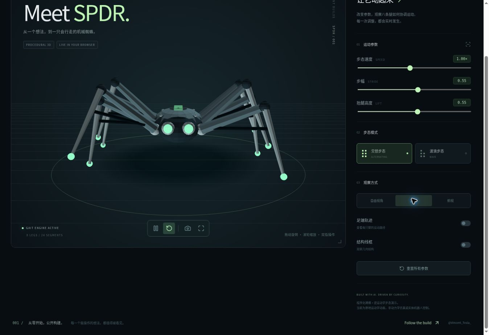

# SPDR · Vincent Builds

### Eight legs. One browser.

An AI-assisted, interactive robot gait study built with **React, TypeScript and Three.js**. Change the parameters, switch the gait, and inspect the math behind the motion.

[Live demo](https://vincent-spider-lab.cabledtoucan1.chatgpt.site) · [Project walkthrough](https://vincent-spider-lab.cabledtoucan1.chatgpt.site/project) · [中文介绍](docs/README.zh-CN.md)



## Explore

- Eight procedural legs with a shared two-link inverse-kinematics solver.
- Alternating and wave gait patterns.
- Live speed, stride and leg-lift controls.
- Orbit, front and top views; drag to rotate and scroll to zoom.
- Foot-path visualization, wireframe view, pause/resume and reset.
- Presentation mode for screen recording and canvas screenshot export.
- Three.js WebGL renderer plus a Canvas fallback projecting the same 3D joint positions.

**This is an in-place kinematics prototype.** It does not simulate gravity, friction, collisions, balance or terrain. It is not a physical robot controller. Coordinates use arbitrary model units; speed controls phase rate, not ground velocity.

## Run locally

Use Node.js **22.13+** (Node 24 LTS recommended) and npm:

```bash
git clone https://github.com/1988-Vincent/vincent-builds-spdr.git
cd vincent-builds-spdr
npm install
npm run dev
```

Open the URL printed by Vite. No API keys or accounts are needed locally.

```bash
npm test             # numerical gait checks
npm run typecheck    # TypeScript validation
npm run build        # production bundle
npm run preview      # preview the production bundle locally
```

Direct dependencies are pinned. The first install requires npm registry access and generates a lockfile for transitive dependencies.

## Read the source

| File | Purpose |
| --- | --- |
| [app/page.tsx](app/page.tsx) | Procedural model, WebGL scene and control panel |
| [lib/gait.ts](lib/gait.ts) | Gait phases, foot targets and two-link IK |
| [app/canvas-renderer.ts](app/canvas-renderer.ts) | 3D projection, polygon sorting and fallback camera |
| [app/globals.css](app/globals.css) | Responsive design and presentation mode |
| [scripts/verify-gait.mjs](scripts/verify-gait.mjs) | Numerical invariants |

[Architecture](docs/ARCHITECTURE.md) · [Build notes](docs/BUILD_LOG.md) · [Roadmap](docs/ROADMAP.md) · [Video guide](docs/VIDEO_GUIDE.md)

## Verification

**9,216 sampled kinematic configurations pass:** finite coordinates, reachable targets, fixed link lengths, nominal ground clearance and cycle closure. These checks do not establish physical stability.

The Canvas fallback was visually checked in the available browser: motion controls, gait switching, trails and presentation mode. That browser could not initialize WebGL; the WebGL path has type/build checks but remains visually unverified there. Mobile performance has not been measured. The fallback may show polygon-order artifacts where geometry intersects.

## Provenance and permissions

Created for **Vincent Builds** with AI assistance. This repository contains the standalone React/Vite edition of the hosted demo with the same core renderer and gait code. The hosted documentation viewer is separate; Site credentials, account records and deployment history are excluded.

Original code is source-available under [LICENSE](LICENSE); no general open-source license has been granted. Third-party packages retain their own licenses: [notices](THIRD_PARTY_NOTICES.md).

Follow the next iteration: [@Vincent_Tesla_](https://x.com/Vincent_Tesla_).
